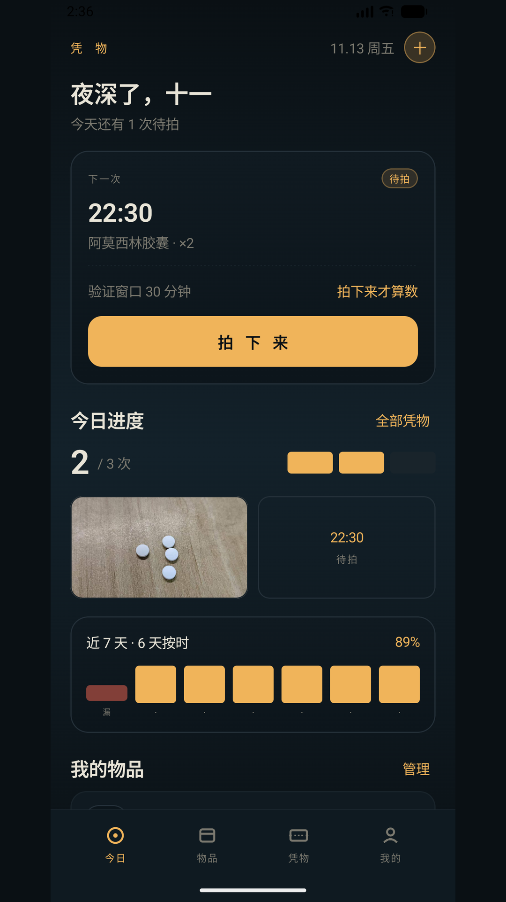
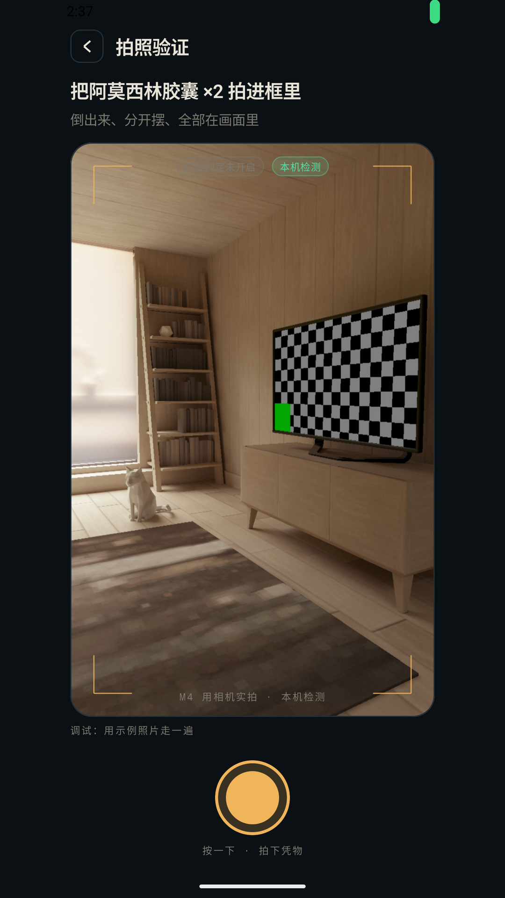
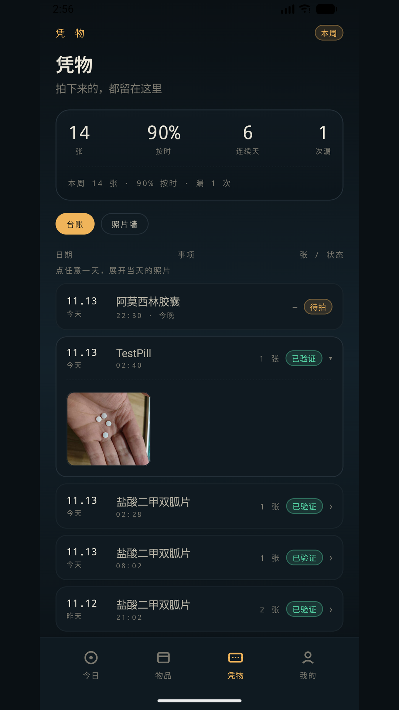

# 凭物 · PingWu

> 拍下来，才算真的做过。

到点提醒你；**拍到那件东西，才算完成**。

第一版从「吃药」开始，但绑的可以是任何一件怕忘的事：钥匙、垃圾袋、门锁、水杯、体检单。
把提醒绑在一件具体的物品上，用一张现场照片作为「在场证明」。

---

## 为什么做这个

普通的提醒按一下「知道了」就过去了，转身就忘。
凭物把「完成」定义成一件必须付出动作的事：**把镜头对准那件东西，拍下来**。

同时也把话说明白：照片只能证明这件东西此刻在画面里，不能证明你真的做了。
App 里所有文案都按这个分寸写。

## 功能

- **今日**：今天还剩几次待拍、下一次是什么、近 7 天按时情况
- **物品**：名字、剂量、每次几片、每天几次、每件的「认得的样子」（可多块）
- **到点**：全屏提醒页 + 闹钟音量铃声与振动；铃声可选系统铃声或自己上传，振动可关
- **拍照**：本机比对登记照（ORB 特征）+ 片数核对；数量不符或样子差太多会拒绝并给出原因
- **在线识别**（可选）：自带 API Key、任意 OpenAI 兼容端点；默认关闭，开启时照片会离开本机
- **凭物**：按天展开当天照片的台账；也能进物品详情按物品看它的全部照片；
  「已删除」段长按可多选彻底删除（记录 + 照片一起走）
- **我的**：双主题（深墨 / 纸白）、提醒声音、验证窗口、盲拍模式、凭物数据（CSV 导出 / 清理）、
  在线识别设置、权限自检
- **完成卡 / 凭物回执**：票根样式，带编号、日期、物品与服务数量

## 截图

| 今日 | 拍照 | 凭物 |
| --- | --- | --- |
|  |  |  |

## 技术栈

- Kotlin + Jetpack Compose（Material 3 组件自绘，无第三方 UI 库）
- Room（`pw_item` / `pw_subject` / `pw_reminder` / `pw_occurrence` / `pw_evidence`）
- Navigation Compose、WorkManager 之外的自行调度：`AlarmManager.setAlarmClock` + BootReceiver 自愈
- OpenCV（ORB 特征 + 单应性）做本机模板比对；可选 YOLOX-Nano 单类检测器（`assets/pill_detector.onnx`）
- 相机：CameraX
- 在线识别：`HttpURLConnection` + JSON，无额外网络依赖

## 构建

需要 **JDK 17** 与 **Android SDK 37**（compileSdk 37 / targetSdk 36 / minSdk 26）。

```bash
# 1. 指向你的 SDK
echo "sdk.dir=/path/to/android-sdk" > local.properties

# 2. 构建
./gradlew :app:assembleDebug        # macOS / Linux
gradlew.bat :app:assembleDebug      # Windows
```

`local.properties`、`.gradle/`、`build/` 都已忽略。
如果你要固定 JDK，取消 `gradle.properties` 里 `org.gradle.java.home` 那行的注释并改成自己的路径。

单测与静态检查：

```bash
./gradlew :app:testDebugUnitTest :app:lintDebug
```

## 目录

```
app/src/main/java/com/pingwu/app/
├── cv/            本机识别：检测、ORB 模板比对、质量与判定
├── data/          Room 实体 / DAO / 仓库 / 在线识别客户端 / 提醒声音偏好
├── domain/        提醒规则、时间计算、判定的纯逻辑（有单测覆盖）
├── reminder/      闹钟调度、通知、全屏验证页、开机与时间变更自愈
├── ui/            Compose：根导航、主题、通用组件、各页面与 ViewModel
└── util/          照片存储、证据清理、CSV 导出
docs/              产品大纲、里程碑开发记录、上架材料与隐私说明
```

## 隐私

- 照片只存在 App 私有目录（`files/evidence`、`files/items`），不上传，除非你自己打开在线识别
- 在线识别默认关闭；开启后照片会发给你配置的服务商，App 内会明确提示这一点
- 无账号、无统计上报、无广告
- 详细说明见 [隐私政策](docs/release/隐私政策.md)

## 免责声明

本 App 不是医疗器械，不提供任何诊断或用药建议；提醒可能受系统省电策略影响而延迟，
重要事项请自行留出余量。

## 许可

[Apache License 2.0](LICENSE)。第三方组件的许可说明见 [NOTICE](NOTICE)。
